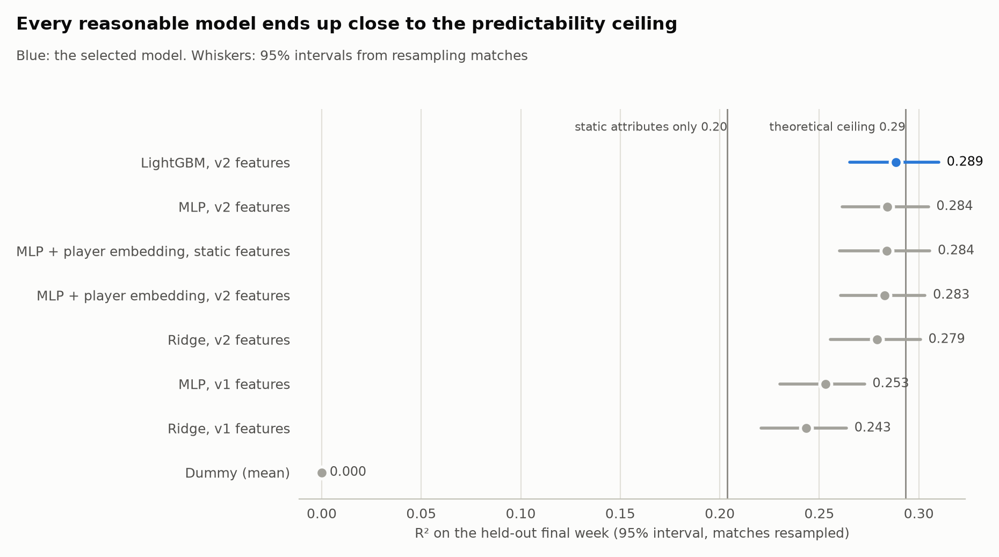
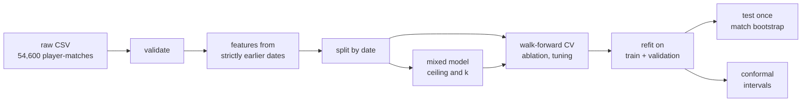
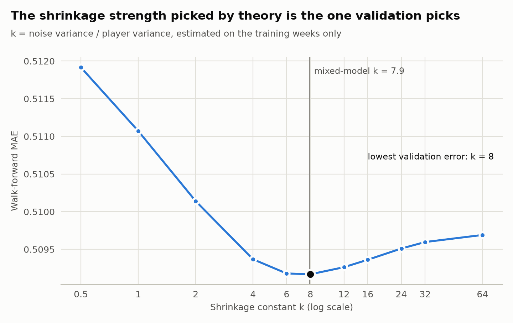
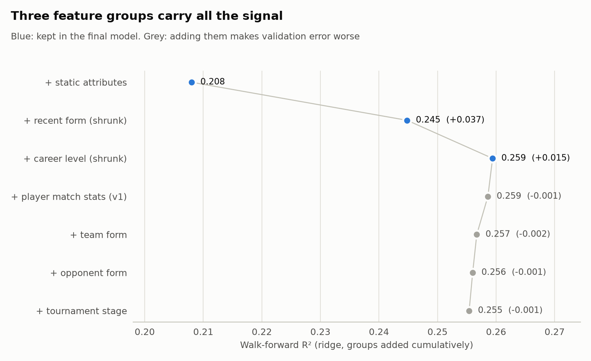
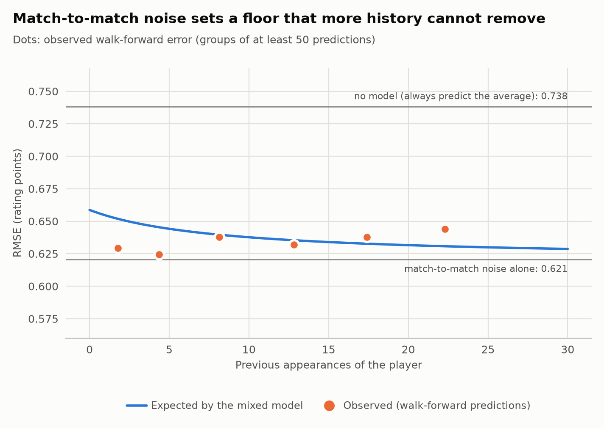
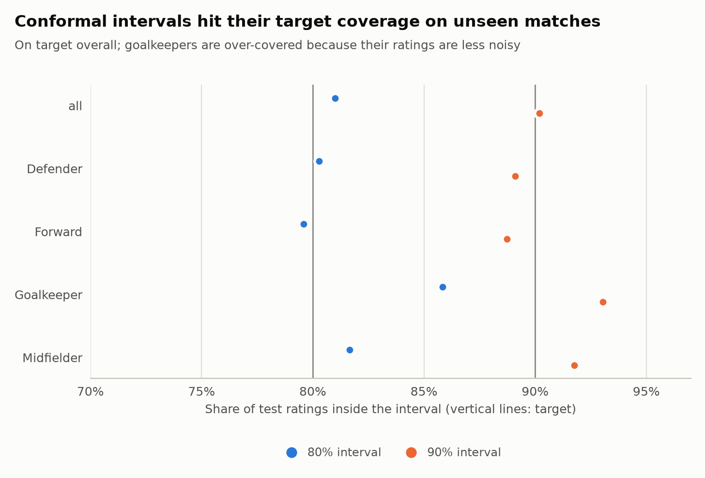

# Player rating forecast

Predicting a football player's match rating **before kick-off**. The project builds features
that only use the past, measures how much of the rating can be predicted at all, compares
models fairly, and puts calibrated intervals around each forecast.

`Python 3.12` · `PyTorch` · `scikit-learn` · `LightGBM` · `statsmodels` · `Optuna` · `pytest` · `GitHub Actions`

> **About the data.** The Kaggle dataset ([details](data/README.md)) turned out to be
> **synthetic** ([audit](notebooks/01_data_audit.ipynb)). The project uses it as a sandbox for
> methodology. Its football conclusions do not transfer to real matches.

## TL;DR

- **There is a hard ceiling.** A mixed-effects model shows that 71% of the rating's variance
  is match-to-match noise. No pre-match model can go beyond **R² ≈ 0.29** on this data.
- **Better statistics beat more features.** The first version used 41 hand-made features
  (51 columns after one-hot encoding), mostly "last 5 matches" averages. Replacing them with
  9 inputs, including an empirical-Bayes estimate of each player's level, raises test R²
  from **0.243 to 0.279** with the same ridge regression (MAE 0.521 → 0.507).
  The shrinkage strength derived from the mixed model (k ≈ 7.9) is the same one walk-forward
  validation picks.
- **Model choice matters far less than features.** Ridge, LightGBM, an MLP and an MLP with
  learned player embeddings all finish within 0.0035 MAE of each other (R² 0.279–0.289),
  just under the ceiling. The embedding network recovers each player's level from the player
  id alone.
- **Honest uncertainty.** Split-conformal intervals of ±0.81 (80%) and ±1.05 (90%)
  covered 81.0% and 90.2% of the ratings in the unseen final week.

<picture>
  <source media="(prefers-color-scheme: dark)" srcset="reports/figures/model_comparison_dark.png">
  
</picture>

## Results

Test week: 24–31 July 2026. The table covers the 4,543 player-matches the v1 model could also
predict. The 95% intervals come from resampling whole matches (2,000 bootstrap resamples).

| Model | Inputs | MAE [95% CI] | R² [95% CI] | Δ MAE vs v1 ridge [95% CI] | Walk-forward MAE / R² |
|---|---|---|---|---|---|
| **LightGBM, v2 features** | 9 | 0.504 [0.493, 0.515] | 0.289 [0.265, 0.310] | -0.0169 [-0.0210, -0.0131] | 0.506 / 0.267 |
| MLP, v2 features | 9 | 0.505 [0.494, 0.516] | 0.284 [0.262, 0.305] | -0.0157 [-0.0191, -0.0123] | 0.507 / 0.264 |
| MLP + player embedding, static features | 6 + player id | 0.505 [0.494, 0.517] | 0.284 [0.260, 0.306] | -0.0157 [-0.0199, -0.0114] | 0.509 / 0.260 |
| MLP + player embedding, v2 features | 9 + player id | 0.505 [0.494, 0.517] | 0.283 [0.261, 0.303] | -0.0152 [-0.0187, -0.0118] | 0.507 / 0.264 |
| Ridge, v2 features | 9 | 0.507 [0.496, 0.519] | 0.279 [0.256, 0.301] | -0.0134 [-0.0173, -0.0095] | 0.509 / 0.260 |
| MLP, v1 features | 41 | 0.516 [0.504, 0.528] | 0.253 [0.230, 0.273] | -0.0047 [-0.0070, -0.0024] | 0.518 / 0.232 |
| Ridge, v1 features | 41 | 0.521 [0.509, 0.532] | 0.243 [0.221, 0.264] | reference | 0.518 / 0.230 |
| Dummy (mean) | – | 0.599 [0.586, 0.613] | 0.000 [-0.001, 0.000] | +0.0781 [+0.0689, +0.0875] | 0.589 / 0.000 |

Neural networks: predictions averaged over 5 seeds. Across seeds, the standard deviation of a single network's test MAE is at most 0.0015.

*Δ MAE*: paired difference against the v1 ridge model, on the same bootstrap resamples.
*Walk-forward*: out-of-fold predictions for the four weeks before the test week, pooled, on
the same rows for every model.
Theoretical ceiling: R² 0.293. Static attributes alone: R² 0.204.

**Selected model: LightGBM, v2 features.** The rule, fixed before looking at the test set: take the
simplest model whose MAE is statistically indistinguishable from the best one, meaning the
95% interval of its MAE difference to the best model contains 0. The differences between the
v2 models (≤ 0.0035 MAE) are far below anything that matters in practice.

## The problem

- **Unit:** one player in one match, for players who end up playing at least 30 minutes.
- **Target:** `player_rating`, between 0 and 10.
- **Inputs:** only what is known before kick-off. That means player attributes and anything
  computed from **strictly earlier** match dates.
- **Split:** by date. The model trains on 11 June – 16 July, is validated on 17–23 July and is
  tested once on 24–31 July. Hyperparameters are tuned on four expanding walk-forward folds
  inside train + validation.



## How leakage is prevented, and tested

Every feature for a match on date D follows the same recipe:

1. aggregate to one row per player (or team) and date, so two matches on the same day never
   see each other;
2. `shift(1)` inside each player or team;
3. apply a window: the last 5 dates, all earlier dates, or the last 5 appearances.

Everything that learns from data sits inside a scikit-learn pipeline and is fitted on training
rows only. That covers scaling, one-hot categories, the prior of the shrinkage estimator and
the player-to-embedding index.

The rule is tested, not just stated. `checks.assert_no_future_leakage` changes every outcome
from a cutoff date onwards and rebuilds all features, and none of the features up to the
cutoff may change. It runs on a hand-made mini tournament in CI and on the real data locally.
A deliberately leaky version of the code (one missing `shift(1)`) fails it.

## Key findings

### 1. How much is predictable

The mixed model splits the rating into a static part (market value, age, position, ...), the
player's own level and match noise. All three are estimated on the training weeks only:

| Component | Variance | Share |
|---|---|---|
| Static attributes | 0.111 | 20% |
| Player's own level | 0.049 | 9% |
| Match-to-match noise | 0.385 | 71% |

A forecaster that knew every player's true level would reach R² = 0.293. That is the ceiling.

### 2. Shrinkage beats windows

The v1 model averaged each player's last 5 matches. That is a noisy estimate when 71% of the
variance is noise. The empirical-Bayes estimate weighs the player's own average by
n / (n + k) and a prior learned from player attributes by k / (n + k), with
k = noise variance / player variance ≈ 7.9. Walk-forward validation picks the same value:

<picture>
  <source media="(prefers-color-scheme: dark)" srcset="reports/figures/shrinkage_k_dark.png">
  
</picture>

### 3. Most of the original 41 features were noise

Adding feature groups one at a time shows where the signal is. Past goals, xG and passes,
team form, opponent form and the tournament stage all make validation error slightly worse
once the player's level is estimated well.

<picture>
  <source media="(prefers-color-scheme: dark)" srcset="reports/figures/ablation_dark.png">
  
</picture>

### 4. The network learns the same thing

The PyTorch model with a per-player embedding (`nn.Embedding(n_players + 1, 1)`, index 0 for
unseen players) is a learned random intercept. Its L2 penalty plays the role of the mixed
model's prior on player levels, so the two approaches estimate the same quantity. Fed only
static attributes plus the embedding, the network reaches R² 0.284: it rediscovers
the player effect without any hand-made history features.

### 5. Errors are dominated by noise that history cannot remove

Whatever the length of a player's history, the error stays between 0.62 and 0.65. That is just
above the match-noise floor of 0.62 and far below the 0.74 of always predicting the average.

<picture>
  <source media="(prefers-color-scheme: dark)" srcset="reports/figures/error_vs_history_dark.png">
  
</picture>

## Prediction intervals

Split conformal prediction calibrates on the out-of-fold errors from the walk-forward weeks.
That gives 14,040 errors, all from matches the model had not seen. The interval
ŷ ± q then covers the target share of new ratings without assuming normal errors. Even a
forecaster that knew every player's true level would need about ±0.80 for 80% coverage,
because the match noise has σ ≈ 0.62 (assuming it is Gaussian). The conformal intervals are
only 2–3% wider than that.

<picture>
  <source media="(prefers-color-scheme: dark)" srcset="reports/figures/interval_coverage_dark.png">
  
</picture>

Overall coverage hits the target. By position it does not quite:

- goalkeepers' ratings are less noisy, so their intervals are too wide (86% and 93%);
- forwards' intervals are slightly too narrow (80% and 89%).

Split conformal guarantees coverage on average, not for every subgroup. Calibrating per
position is on the roadmap.

## Project evolution

| | v1 (original notebook) | v2 (this repository) |
|---|---|---|
| Features | 41 (51 after one-hot), mostly "last 5 dates" averages | 9: attributes + shrunk recent form and career level |
| Leakage control | careful code, checked by eye | the same rules, plus automated perturbation tests |
| Validation | one validation week | walk-forward CV over four weeks, same tuning budget per model |
| Model comparison | single run, point estimates | 5 seeds per network, match-level bootstrap intervals |
| Best test R² | 0.245 (Keras ANN) | 0.289 (LightGBM, v2 features) |
| Knows its ceiling | no | yes (0.293, mixed model) |
| Uncertainty | none | conformal 80% / 90% intervals |
| Code | one notebook | tested package, CI, pinned environment, three notebooks |

The refactor first reproduced the v1 ridge result exactly (MAE 0.5221, R² 0.2402) before
changing anything.

## Limitations and next steps

- **Synthetic data.** The method transfers; the football conclusions do not. The next project
  applies the same pipeline to real event data (StatsBomb open data, real World Cup 2026
  datasets).
- **Conditional target.** The model assumes the player will play at least 30 minutes. A real
  forecast would combine it with a model of P(plays ≥ 30 minutes).
- **Next steps:** a Streamlit demo, SHAP explanations, per-position (Mondrian) conformal
  intervals, and visualising the learned player embeddings against the mixed-model
  estimates.

## Reproduce

```bash
git clone <this repository> && cd <repository>
python -m venv .venv && source .venv/bin/activate      # Python 3.11 or 3.12
pip install -r requirements-torch-cpu.txt              # CPU-only PyTorch (~200 MB)
pip install -r requirements.txt && pip install -e . --no-deps
# download the CSV into data/raw/ (see data/README.md)

pytest -m "not data"               # 19 tests that need no data (what CI runs); plain pytest adds the real-data check
python -m player_rating.pipeline   # features, ceiling, tuning, final fits, intervals, figures (~25 min on 4 CPU cores)
python -m player_rating.plots      # redraw the figures from reports/metrics without retraining
jupyter nbconvert --to notebook --execute --inplace notebooks/*.ipynb
```

With `make` installed, the same steps are `make setup`, `make test`, `make pipeline`,
`make figures` and `make notebooks`.

## Repository structure

```
├── data/README.md            where to get the CSV, checksum, why it is synthetic
├── notebooks/
│   ├── 01_data_audit.ipynb   is the data what it claims to be?
│   ├── 02_modeling.ipynb     features, ceiling, ablation, model comparison
│   └── 03_uncertainty.ipynb  conformal prediction intervals
├── reports/                  metrics (CSV/JSON) and figures produced by the pipeline
├── src/player_rating/
│   ├── data.py               loading, cleaning, validation
│   ├── features.py           leakage-safe history features
│   ├── checks.py             executable leakage check
│   ├── splits.py             date split and walk-forward folds
│   ├── models/               preprocessing (shrinkage, player index), ridge, LightGBM,
│   │                         PyTorch MLP with embeddings, mixed model
│   ├── tuning.py             walk-forward CV and Optuna search
│   ├── experiments.py        model registry, ablation, selection rule
│   ├── evaluate.py           metrics and match-level bootstrap
│   ├── uncertainty.py        split conformal intervals
│   ├── plots.py              figures (light and dark)
│   └── pipeline.py           end-to-end run
└── tests/                    leakage, splits, models, uncertainty
```

## Model card

- **Intended use:** a portfolio demonstration of forecasting methodology on tabular sports
  data.
- **Not for:** betting, scouting or any decision about real players. The data is synthetic.
- **Inputs:** player attributes, the player's earlier ratings and how many appearances they
  are based on.
- **Output:** the expected rating for a player who plays at least 30 minutes, with an 80% or
  90% interval.
- **Known weaknesses:** per-position coverage differs from the target, and the model assumes
  the noise level stays stable over time.
